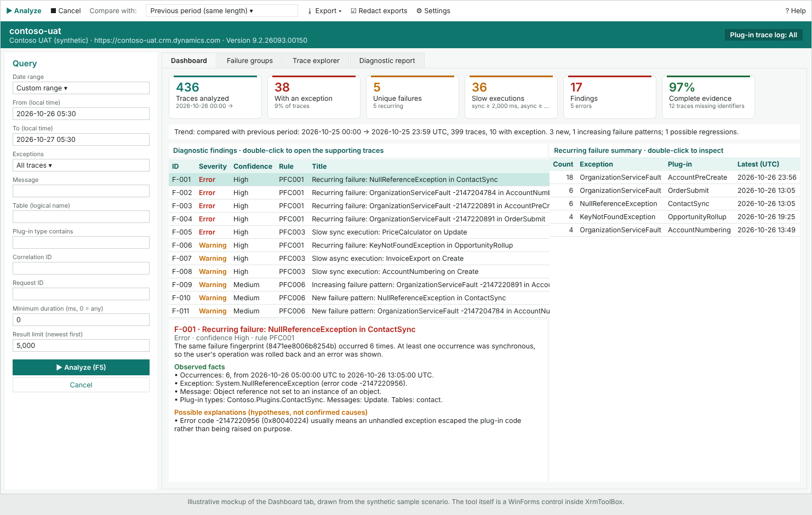

# Plugin Failure Correlation Explorer

An XrmToolBox tool that correlates Dataverse plug-in failures, identifies recurring exceptions, analyzes execution patterns and generates evidence-based diagnostic reports from plug-in trace logs.

It isn't another trace viewer. Retrieving and listing traces is only the foundation. The tool's value is in what it adds on top:

- **Correlation with explicit evidence.** Every link between traces says how strong the evidence is and which signals produced it.
- **Recurring-failure fingerprints.** Generic messages from different plug-ins never merge.
- **Rule-based findings.** Observed facts are kept apart from hypotheses.
- **Trend comparison.** The tool refuses to compare when the data can't support it.

It is read-only: it never changes data, step registrations or trace logs.



*Illustrative mockup drawn from the synthetic sample scenario.*

## How it complements other tools

| Tool | Focus |
| --- | --- |
| Plugin Trace Viewer | Browse and read individual trace logs |
| Diagnostics Workbench (same repository) | Error grouping, slow steps, correlation chains, step configuration flags |
| **Plugin Failure Correlation Explorer** | Evidence levels for every correlation, rule-based findings with confidence and next steps, trend comparison against a validated baseline, redacted reports for sharing |

## Features

| Area | What you get |
| --- | --- |
| **Retrieval** | Server-side filters: date range, exception presence, message, table, plug-in type, correlation ID, request ID and minimum duration. Results come newest first, 5,000 rows per page, up to a result limit you set (100,000 maximum). Retrieval can be cancelled. The summary query never reads the large text columns. Exception text is loaded for failed traces only, and trace text when you open a trace. |
| **Dashboard** | Organization, URL, environment ID, version and trace log setting. Tiles for traces, exceptions, unique failures, slow executions, findings and evidence completeness. A trend line, the findings grid with full evidence, and a summary of recurring failures. |
| **Failure groups** | Fingerprint, severity, exception and error code, message, count, first and latest occurrence, plug-in types, tables and rate. The detail pane explains *why* the traces are grouped: rules applied, normalized message, user frames and the exact hashed input. Double-click a group to open its traces. |
| **Trace explorer** | A searchable, sortable grid with exception-only and slow-only filters. The detail panel shows the trace, step, assembly, identifiers, exception and trace output, with find-in-text and copy buttons for IDs and a ticket-ready summary. It lists related traces with their evidence level and explanation, and lets you step backwards and forwards through a correlation chain. |
| **Diagnostic report** | A live preview, plus export to standalone HTML (no scripts), JSON and CSV (findings, failure groups, performance, traces). |
| **Trend comparison** | Compare with the previous period of the same length (queried live) or with a saved aggregate snapshot. New and increasing failure patterns and performance regressions are found only when the baseline is valid. |
| **Settings** | Thresholds, sample sizes, ratios, grouping mode, custom normalization rules and report privacy values. Settings are saved per connection. |

## How fingerprinting works

The text in `exceptiondetails` is parsed into:
- the exception type, using the inner .NET type when the outer type is the generic `FaultException<OrganizationServiceFault>`
- the Organization Service error code
- the first message line
- the user stack frames (frames outside the `System.`, `Microsoft.Xrm.`, `Microsoft.Crm.` … namespaces)

The message is then normalized. Custom rules run first, followed by these built-in rules in this order:

| Rule | Replaces | Token |
| --- | --- | --- |
| `guid` | GUIDs, with or without braces | `<guid>` |
| `iso-datetime` | `2026-10-20T09:15:22.123Z`, `2026-10-20 09:15:22+05:30` | `<datetime>` |
| `locale-datetime` | `10/20/2026 9:15:22 AM`, `20.10.2026` | `<datetime>` |
| `time` | `14:03:22`, `2:03:22 PM` | `<datetime>` |
| `reference-number` | Dataverse support references such as `#8A1B2C3D` | `#<ref>` |
| `url` | URLs | `<url>` |
| `email` | e-mail addresses | `<email>` |
| `double-quoted`, `single-quoted` | quoted values (record names, inputs) | `<str>` |
| `il-offset`, `line-number` | `+0x1a`, `:line 42` | `+<offset>`, `:line <n>` |
| `number` | numbers with 2 or more digits | `<n>` |

Hex error codes such as `0x80040217` and parenthesized status codes such as `(404)` are kept, because they tell failures apart. Whitespace is collapsed and the text is lowercased.

The fingerprint is the first 16 hex characters of SHA-256 over:

```
v1|type=<exception type>|code=<error code>|msg=<normalized message>|plugin=<plug-in type without assembly>|frames=<top N user frames>
```

Two details matter here:
- **Plug-in type and frames are included.** This is why "Object reference not set to an instance of an object." from two plug-ins, or from two methods of one plug-in, stays in separate groups.
- **Assembly versions and line numbers are excluded.** So a failure keeps its fingerprint across deployments.

The original exception text is never modified. You can change the grouping in Settings:
- by fingerprint (the default)
- by exception and message only, across plug-ins
- by fingerprint, split further by message and table

Every rule is covered by unit tests in `tests/…/FingerprintTests.cs`.

## Evidence levels

| Level | Signal | What it proves | What it doesn't |
| --- | --- | --- | --- |
| **Exact match** | Same `requestid` | Same message request | – |
| **Same causal chain** | Same `correlationid` | Same causal chain | That the traces are the same immediate operation. Chains span several operations and async continuations. |
| **Suspected parent/child** | Same chain, depth differs by 1, the child runs inside the parent's execution window, and there is exactly one candidate parent | Consistent nesting | Dataverse doesn't record parent/child links, so this is never "confirmed". |
| **Heuristic** | No shared identifier. Within N seconds, and at least 2 of plug-in type, message and table match | A lead to check | A shared transaction. Traces whose correlation IDs are both known and different are never linked. Time proximity alone never links anything. |
| **Same pattern** | Same fingerprint | Recurrence | A shared transaction |

## Diagnostic rules

Each finding has the following fields:
- ID
- severity
- confidence
- title and description
- **observed facts**
- **calculated metrics**
- **correlation evidence**, labelled by level
- **possible explanations**, always presented as hypotheses
- recommended investigation steps
- supporting trace IDs
- rule ID

| Rule | Finding | Confidence |
| --- | --- | --- |
| PFC001 | A failure fingerprint recurs (default ≥ 3). Error when synchronous, Warning when only asynchronous | High |
| PFC002 | High-frequency failure (default ≥ 30/h over its active span) | High |
| PFC003 | Executions at or above the sync/async threshold. Error near the 2-minute synchronous timeout | High |
| PFC004 | Failures on one message and table spread over several failure groups or plug-in types | High |
| PFC005 | Incomplete evidence: missing identifiers, trace logging Off or Exception-only, result limit reached | High |
| PFC006 | New or increasing failure pattern compared with a valid baseline | Medium |
| PFC007 | Median duration regression compared with a valid baseline | Medium |
| PFC008 | Failures from several plug-in types or depths in one causal chain. Chains with the same shape are reported once | Medium |
| PFC009 | The same plug-in type and message at 3 or more depths in one chain (suspected recursion) | Low |

A rule that throws on unexpected data is isolated. It becomes an Information finding, and the other rules still run. To add a rule, implement `IDiagnosticRule` and pass it to `AnalysisEngine`.

## Performance analysis

Executions are grouped by plug-in type, message and mode. A trace is only called slow when all three of these hold:
- its duration is recorded
- its mode is known
- the duration meets the configured threshold for that mode (default 2,000 ms sync, 10,000 ms async)

The statistics have minimum sample sizes:
- Average and median need 5 measured executions.
- The 95th percentile uses the nearest-rank method (an observed value, rank = ⌈0.95 × n⌉) and needs 20.

When a statistic is missing, the report says why. Constructor time is reported separately from execution time.

## Trend comparison and baselines

Choose **Compare with** on the toolbar.

- **Previous period (same length).** The same filters are queried for the period immediately before the current one.
- **Saved snapshot.** Turn on *Save an aggregate snapshot after each analysis* in Settings. A snapshot holds counts, fingerprint keys, exception and plug-in type names, and duration statistics. It never holds exception text, trace text, record IDs, users or trace identifiers. Snapshots are stored locally in the XrmToolBox settings folder, with the 20 most recent kept per connection.

The comparison is refused, and the reason is shown instead of a trend, in any of these cases:
- the filters differ
- the grouping settings differ
- the periods overlap
- the baseline has no traces (retention may have deleted them)
- the baseline was cut short by the result limit

Rates are compared per hour of each period. When the current retrieval hit the limit, decreases and patterns that are no longer seen are not reported, because the current counts are lower bounds.

## Reports and privacy

- **Report contents.** Organization and environment, analysis date, time range, filters and limit, totals, and evidence completeness. Also recurring failure groups, performance anomalies, correlation evidence, the trend comparison or why it's unavailable, all findings, recommended steps, and limitations.
- **Credentials are always removed**, in every export and in the copied summary: bearer tokens, JWTs, `Password=` and `ClientSecret=` pairs, and SAS/OAuth URL parameters (`sig`, `code`, `access_token`, …).
- **Optional redaction** (*Redact exports*, on by default): GUIDs become stable placeholders (`[GUID-1]`, `[GUID-2]` …, so links stay recognizable within one report), e-mail addresses become `[EMAIL]`, and URL query strings are removed.
- **Custom values** from Settings → *Report privacy* are always removed.
- **Trace text is never exported**, including the message block and the step configuration. The configuration columns are never even queried.
- **HTML safety.** The HTML report is one file with inline CSS. It contains no scripts, carries a Content-Security-Policy that blocks them, and HTML-encodes every value.
- **CSV safety.** Cells that start with `=`, `+`, `-` or `@` are prefixed so spreadsheets don't evaluate them.

See [samples/sample-report.html](samples/sample-report.html) for a report built from synthetic data.

## Reliability

- **Dataverse calls.** All Dataverse calls run in the background through XrmToolBox `WorkAsync`. Progress is shown, and you can cancel between pages.
- **Service protection limits.** These are retried at most twice, honouring `Retry-After` (capped at 60 s). Other errors are not retried.
- **Error messages.** Insufficient privileges, expired sessions, network errors and timeouts get plain-language messages without stack traces. The full exception goes to the XrmToolBox log only.
- **Missing data.** Missing fields are handled throughout. Duplicate rows at page boundaries are counted once.
- **Bounded memory.** The step-metadata cache and the related-trace lists are bounded.
- **Exception filter fallback.** If an environment rejects the server-side "has exception" filter, exception text is loaded by trace ID instead, and the report says so.

## Permissions

The tool needs read access to:
- `plugintracelog`
- `organization` (name and trace setting)
- optionally `sdkmessageprocessingstep`, `plugintype` and `pluginassembly` (step and assembly details; the tool falls back to the trace's type name without them)

## Build and test locally

Requirements: Visual Studio 2022 or later (or the .NET SDK) with the .NET Framework 4.8 targeting pack, and XrmToolBox.

1. **Close XrmToolBox.** A Debug build copies `PluginFailureCorrelationExplorer.dll` into `%APPDATA%\MscrmTools\XrmToolBox\Plugins`.
2. Open `PluginFailureCorrelationExplorer.sln` and build **Debug**, or run:
   ```
   dotnet build src\PluginFailureCorrelationExplorer\PluginFailureCorrelationExplorer.csproj -c Debug
   ```
3. Run the unit tests. No test framework or packages are needed:
   ```
   dotnet run --project tests\PluginFailureCorrelationExplorer.Tests
   ```
4. Start XrmToolBox and open **Plugin Failure Correlation Explorer**. The *XrmToolBox* launch profile does this from Visual Studio with F5. Edit its path in `Properties/launchSettings.json` if needed.
5. Regenerate the sample reports with:
   ```
   dotnet run --project tests\PluginFailureCorrelationExplorer.Tests -- --samples samples
   ```

Set `CopyToXrmToolBox=false` if you don't want Debug builds copied to the Plugins folder.

Testing against a real environment is described in [docs/INTEGRATION-TEST-PLAN.md](docs/INTEGRATION-TEST-PLAN.md). The design is in [docs/ARCHITECTURE.md](docs/ARCHITECTURE.md).

## Known limitations

- **Retention.** Dataverse deletes plug-in trace logs after a retention period, so trends further back need saved snapshots.
- **Trace setting.** When tracing is Off, nothing new is logged. When it is Exception-only, successful executions are missing, so performance statistics and failure shares cover failures only. The tool warns about both.
- **Parent/child inference** needs recorded durations, and is skipped when more than one parent is possible.
- **Heuristic correlation** can't tell apart unrelated executions that share type, message and table within the time window. That's why these links are labelled heuristic.
- **Fingerprints and code changes.** A fingerprint changes when the plug-in type or the top user frames change, for example after a refactoring. Use *Exception and message only* grouping to compare across such changes.
- **Report preview.** The preview uses the Windows WebBrowser (IE11) engine. The exported file is meant to be opened in a modern browser.
- **"Has exception" filter.** This server-side filter has been implemented from the documented FetchXML `not-null` operator but not yet confirmed on a live environment. A fallback is built in (see Reliability).

## Releasing to the XrmToolBox Tool Library

The package follows the same layout as the other tools in this repository:
- `XrmToolBox` is the first tag
- the DLL is under `lib\net48\Plugins\`
- the package depends on the `XrmToolBox` package
- the icon is referenced by URL

The complete checklist is in [docs/PUBLISHING-CHECKLIST.md](docs/PUBLISHING-CHECKLIST.md).

**GitHub Actions (recommended).** `.github/workflows/plugin-failure-correlation-explorer.yml` builds the tool, runs the unit tests, checks that the csproj and nuspec versions match, then packs the package and checks its layout. When a push to `main` carries a version that isn't on nuget.org yet (or a tag `PluginFailureCorrelationExplorer-v<version>` is pushed), it publishes with **Trusted Publishing** and creates a GitHub release.

One-time setup: on nuget.org, add a Trusted Publishing policy for owner `VikashKumar0491`, repository `vikashkumar669/XrmTools`, workflow file `plugin-failure-correlation-explorer.yml`.

**From your PC.**
1. Bump the version in both `PluginFailureCorrelationExplorer.csproj` and `.nuspec`.
2. Run `.\build\pack.ps1` (or `.\build\pack.ps1 -Push -ApiKey <key>`).

## Project layout

```
src/PluginFailureCorrelationExplorer.Core/   analysis core: plain C#, no SDK/UI dependency (net48 + net8.0)
  Models/      PluginTraceRecord, TraceQuery, AnalysisOptions, FailureGroup, CorrelationResult, DiagnosticFinding, Baseline, AnalysisResult
  Analysis/    TraceTextNormalizer, ExceptionParser, ExceptionFingerprintService, FailureCorrelationService,
               PerformanceAnalysisService, Statistics, BaselineService, DiagnosticAnalysisService, AnalysisEngine
  Rules/       IDiagnosticRule and the nine built-in rules
  Reporting/   SensitiveDataRedactor, CsvReportWriter, HtmlReportWriter, JsonReportWriter
  Data/        TraceFetchXml (FetchXML builder, unit-tested)
src/PluginFailureCorrelationExplorer/        XrmToolBox plugin (net48): compiles the core in, ships as one DLL
  Data/        DataverseTraceService (retrieval, paging, details, steps), DataverseErrors (classification, retry)
  Persistence/ BaselineStore (local aggregate snapshots)
  Controls/    Theme, VirtualGrid, KpiTile, SettingsDialog
tests/PluginFailureCorrelationExplorer.Tests/ dependency-free test runner, synthetic fixtures and the sample scenario
samples/       sample HTML, JSON and CSV reports from synthetic data
docs/          architecture, integration test plan, publishing checklist, images
```

## Release notes

**1.2026.10.1**: first release (unit-tested; integration testing against a live environment is pending, see the test plan)
- Retrieval with server-side filters, paging, result limit, cancel and throttling-aware retry
- Exception fingerprinting with documented normalization rules and custom rules
- Evidence-based correlation with five evidence levels and explanations
- Performance analysis with thresholds per mode, average, median and nearest-rank P95
- Nine diagnostic rules with facts, metrics, correlation evidence, hypotheses and recommendations
- Trend comparison with the previous period or saved aggregate snapshots
- HTML, JSON and CSV exports with redaction

## License

MIT. See [LICENSE](https://github.com/vikashkumar669/XrmTools/blob/main/PluginFailureCorrelationExplorer/LICENSE).
