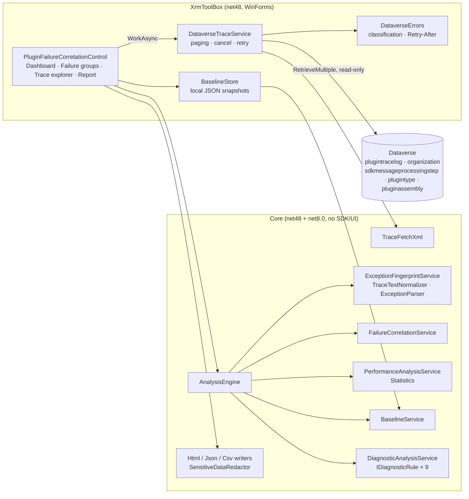

# Architecture

## Constraints that shaped the design

- **The host decides the platform.** XrmToolBox plugins run in-process in XrmToolBox on .NET Framework 4.8 and use WinForms. They are discovered through MEF (`[Export(typeof(IXrmToolBoxPlugin))]` on a `PluginBase`) and receive the connection through `PluginControlBase.UpdateConnection`. Tool Library packages depend on the `XrmToolBox` package and place the DLL in `lib\net48\Plugins\`.
- **The data is incomplete by nature.** Trace logs depend on the organization's trace setting, retention removes them, and not every trace carries every identifier. The design treats missing data as a first-class outcome and never infers more than the evidence supports.
- **One DLL.** Like the other tools in this repository, the analysis core is compiled into the plugin assembly, so nothing extra lands in the shared Plugins folder.

## Components

## Data flow for one analysis

1. **The UI thread builds the query.** `BuildQuery` validates it: date order, the limit range, and well-formed GUIDs.
2. **The background worker runs `WorkAsync`.** Its `IsCancelable` setting and `ProgressChanged` callback drive the progress message and the Cancel button. The worker does the following:
   1. Reads the `organization` name and plug-in trace setting, and the version (optional parts that never fail the analysis).
   2. Retrieves summary pages newest first. These read the summary columns only, never `exceptiondetails`, `messageblock` or the configuration columns. Pages hold 5,000 rows, follow the paging cookie, and stop at the result limit or on cancellation.
   3. Loads `exceptiondetails` for failed traces. It uses the same filters plus `exceptiondetails not-null`, limited to the time window the summary covered. If the server rejects that condition, it falls back to batches of 200 IDs.
   4. Resolves the step, plug-in type and assembly for distinct step IDs (batches of 200, cached and bounded). If this fails, it adds a note.
   5. For *Previous period*, repeats steps 2–3 for the preceding window and builds an aggregate snapshot from it.
   6. Runs `AnalysisEngine.Analyze`, which is pure and deterministic.
3. **The UI thread** (`PostWorkCallBack`) binds the result. It saves a snapshot if that is enabled. Errors are classified into plain messages, and the full exception goes to the XrmToolBox log.
4. **Selecting a trace** loads its `messageblock` on demand after a 350 ms pause, so arrowing through rows doesn't trigger calls.

## The analysis core

| Service | Responsibility |
| --- | --- |
| `TraceTextNormalizer` | Named, ordered regex rules; custom rules first, with a 250 ms timeout; reports which rules applied |
| `ExceptionParser` | Exception type (including the inner type inside OrganizationServiceFault), message, error code, frames, and user frames |
| `ExceptionFingerprintService` | SHA-256 fingerprint, grouping key per `GroupingMode`, `GroupingSignature` for baseline compatibility |
| `FailureCorrelationService` | Indexes by request, correlation ID, fingerprint and start time; clusters; suspected edges; `FindRelated` with evidence levels |
| `PerformanceAnalysisService` | Groups by type + message + mode; thresholds per mode; sample-size-gated statistics |
| `BaselineService` | Aggregate snapshots, like-for-like validation, rate comparison, serialization |
| `DiagnosticAnalysisService` | Runs `IDiagnosticRule`s with isolation; orders and numbers findings |
| `AnalysisEngine` | Orchestrates the services and fills `AnalysisSummary` |

### Why parent/child is only ever "suspected"

Dataverse records `depth` and `correlationid`, but not which execution triggered which. A child edge is proposed only when all of these hold:
- both traces are in the same correlation
- the depths differ by one
- both have recorded durations
- the child's execution window lies inside the parent's, within a tolerance
- **exactly one** candidate parent exists

Ambiguous cases produce no edge, because a guessed structure would be presented as fact.

### Why heuristic links need context

Time proximity is common in busy environments. A heuristic link requires all of these:
- time within the window
- at least two matching context signals (plug-in type, message, table)
- at least one side without a correlation ID

If both correlation IDs are known and differ, the traces are provably in different chains, so they are never linked.

## Threading and resources

- **Threading.** Dataverse calls and the analysis run on the XrmToolBox background worker. The UI only binds results.
- **Grids** use virtual mode, so 100,000 rows don't create 100,000 row objects.
- **Bounds.** The step cache is capped at 5,000 entries. Related-trace lists are capped (25 heuristic, 50 same-pattern), and supporting trace IDs per finding are capped at 25.
- **Retry.** Only service protection faults are retried: at most twice, with waits capped at 60 s and checked for cancellation every 250 ms.

## Security and privacy

- **Read-only.** Only `RetrieveMultiple` and `RetrieveVersionRequest` are called.
- **No configuration columns.** `configuration` and `secureconfiguration` are never queried. `TraceFetchXml` throws if anyone tries to add them.
- **No separate credentials.** The tool uses the XrmToolBox connection and never asks for or stores credentials.
- **Exports.** Credentials are always scrubbed. GUIDs, e-mail addresses and URL queries are redacted optionally, along with custom values. HTML is encoded, the report has no scripts, and a CSP blocks them. CSV cells are protected against formula injection.
- **Snapshots** hold aggregates only and are stored locally in the XrmToolBox settings folder.
- **Logging** records counts, the date range and the filter description. It never records trace content.

## Testing

- **Unit tests.** `tests/PluginFailureCorrelationExplorer.Tests` is a dependency-free runner (`[Test]` static methods). It targets net8.0 on Linux/macOS and net48 on Windows, the same pattern as Diagnostics Workbench.
- **Fixtures.** They are synthetic, built in `Samples.cs` and `SampleScenario.cs`.
- **CI.** The workflow runs the tests before packing.
- **Live testing.** See [INTEGRATION-TEST-PLAN.md](INTEGRATION-TEST-PLAN.md).
